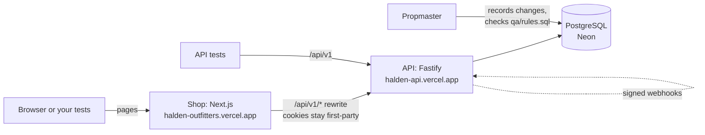
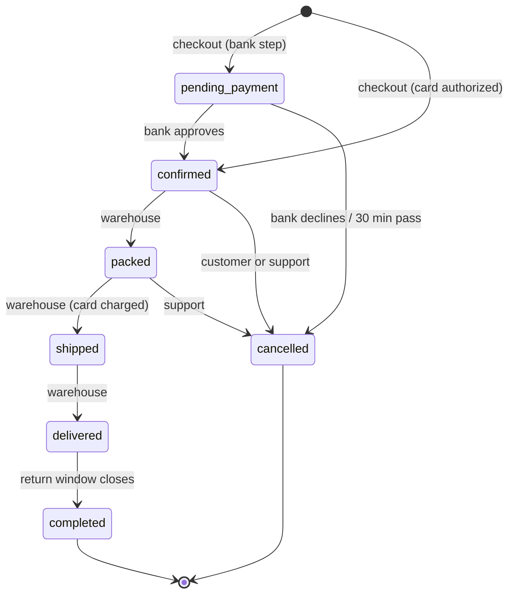

<div align="center">

# ⛰️ Halden Outfitters

**A realistic outdoor-gear web shop, built for QA engineers to practise testing UI, API and data.**

It behaves like a production store, with real business rules, a full staff back office and a mock payment
provider. It also hides **18 planted bugs** you can switch on, each one caught by exactly one SQL rule.

[**🛒 Open the shop**](https://halden-outfitters.vercel.app) ·
[**📘 API docs (try it live)**](https://halden-api.vercel.app/api/v1/docs/) ·
[**🧾 OpenAPI 3.1 spec**](https://halden-api.vercel.app/api/v1/docs/openapi.json) ·
[**🐞 Planted bugs**](#-the-18-planted-bugs) ·
[**🧪 Start testing**](#-pick-your-path)

</div>

> [!NOTE]
> Halden Outfitters is not a real store. Nothing is for sale, no email is ever sent, and payments go to
> **HaldenPay**, a mock card provider with [test card numbers](#-test-data-you-can-use). The shop is free to test
> against, from a browser or from your own automation.

---

## 🎯 Why this exists

Most practice sites are either too simple (a login form and a to-do list) or too fragile to automate against.
Halden is a complete shop you can test the way you test real software:

| You want to practise… | Halden gives you… |
|---|---|
| **UI testing** (Playwright, Cypress, Selenium) | A modern Next.js storefront, desktop and mobile, light and dark, with stable roles and labels to select by |
| **API testing** (Postman, REST Assured, k6, curl) | 86 documented operations, an OpenAPI 3.1 spec, problem+json errors with stable codes, idempotency keys, rate limits |
| **Business-rule testing** | Checkout, payments, cancellations, returns, refunds, store credit, loyalty points and reviews, each with written rules |
| **Data and SQL checks** | `qa/rules.sql`: 38 rules that must hold in the database, and a recorder that checks them per test step |
| **Bug hunting** | [18 planted bugs](#-the-18-planted-bugs) you can switch on. Can your tests catch them? |
| **Time-based rules** | A shop clock you can move forward (31 days, 13 months) to test return windows and point expiry |
| **Email flows** | A fake inbox that shows every email the shop would send, with its links |

---

## 🧭 Pick your path

<details open>
<summary><b>🖱️ I test the UI</b>: click through it in 5 minutes</summary>

1. Open the [shop](https://halden-outfitters.vercel.app) and choose **Create account**. Use an address at a
   **test domain**, such as `you@qa.test` or `you@example.com` (see [why](#-test-data-you-can-use)).
2. Open the [fake inbox](https://halden-outfitters.vercel.app/qa/inbox), type your address, and click the
   confirmation link.
3. Add something to the cart, check out, and pay with card `4000 0000 0000 3220`. You land on the test **bank
   step**: approve it.
4. In **Account → Orders**, cancel the order, or sign in as staff to pack, ship and deliver it, then return it.

**Things worth automating:** the cart drawer, the 4-step checkout with its validation, the bank step, cancel
countdowns, the 3-step returns wizard, reviews and votes, light/dark theme, and the mobile menu.

**Selectors:** use roles and labels (`getByRole('button', { name: 'Add to cart' })`, `getByLabel('Email')`).
Lists that tests need also carry `data-testid` values (`my-review`, `bug-<key>`, `audit-row`, …).

```ts
// Playwright: a shopper signs up and lands on their account
import { test, expect } from '@playwright/test';

test('sign up with a test address', async ({ page }) => {
  await page.goto('https://halden-outfitters.vercel.app/register');
  await page.getByLabel('Your name').fill('Pat Tester');
  await page.getByLabel('Email').fill(`pat-${Date.now()}@qa.test`);
  await page.getByLabel('Password', { exact: true }).fill('a long walk in the woods');
  await page.getByRole('button', { name: 'Create account' }).click();
  await expect(page).toHaveURL(/\/account/);
});
```

The repo's own Playwright suite (`apps/web/e2e`) covers browsing, checkout, the bank step, cancelling, returns,
reviews, accessibility (axe) and the staff console. It's a good reference.

</details>

<details>
<summary><b>🔌 I test the API</b>: a full purchase with curl</summary>

The API lives at `https://halden-api.vercel.app/api/v1` (or `/api/v1` on the shop's own domain). The session is an
HttpOnly cookie, so keep a cookie jar. Every error is `application/problem+json` with a stable `code`.

```sh
API=https://halden-api.vercel.app/api/v1
EMAIL="api-$(date +%s)@qa.test"

# 1. Sign up (you are signed in straight away)
curl -s -c jar -b jar -H 'content-type: application/json' \
  -d "{\"name\":\"Api Tester\",\"email\":\"$EMAIL\",\"password\":\"a long walk in the woods\"}" $API/auth/register

# 2. Read the confirmation email in the fake inbox and confirm
TOKEN=$(curl -s "$API/qa/inbox?email=$EMAIL" | grep -o 'token=[A-Za-z0-9_-]*' | head -1 | cut -d= -f2)
curl -s -b jar -H 'content-type: application/json' -d "{\"token\":\"$TOKEN\"}" $API/auth/verify-email

# 3. Add an address and a product
ADDRESS=$(curl -s -b jar -H 'content-type: application/json' \
  -d '{"name":"Api Tester","line1":"1 Test Way","city":"Testville","postcode":"12345","countryCode":"US"}' \
  $API/account/addresses | grep -o '"id":"[0-9]*"' | head -1 | cut -d'"' -f4)
curl -s -b jar -H 'content-type: application/json' -d '{"productId":"10","qty":1}' $API/cart/items

# 4. Check out (the Idempotency-Key makes a retry safe: the card is charged once)
curl -s -b jar -H 'content-type: application/json' -H "Idempotency-Key: $(uuidgen)" \
  -d "{\"shipTo\":{\"addressId\":\"$ADDRESS\"},\"shippingMethod\":\"standard\",\"card\":{\"number\":\"4242424242424242\",\"expMonth\":12,\"expYear\":2030,\"cvc\":\"123\",\"name\":\"Api Tester\"}}" \
  $API/checkout
```

**Worth testing:** validation errors (one entry per field), `401` vs `403` vs `404` (you can't see other people's
orders, so they're 404), idempotency (same key and body returns the first response, a different body is `422`),
rate limits (`429` with `Retry-After`), optimistic locking on staff product edits (`If-Match`, `412`), cross-site
writes refused by the Origin check, and the order state machine (`allowedActions` on every order).

The [API docs](https://halden-api.vercel.app/api/v1/docs/) list every route, field and error, and can send
requests for you. The written guide is [docs/API.md](docs/API.md).

</details>

<details>
<summary><b>🗄️ I test data</b>: SQL rules and Propmaster</summary>

[`qa/rules.sql`](qa/rules.sql) holds 38 rules the database must always satisfy, such as *the card is authorized for
what the order leaves to pay* or *a line is never refunded more than was paid for it*. Each rule is a query that
returns the rows breaking it.

[Propmaster](https://github.com/rameshlakmal/propmaster) records what each test step changed and checks the rules
against exactly those rows:

```sh
propmaster record start "Return a damaged mug"   # then run your UI or API test, marking steps
propmaster record step "Grade it faulty"
propmaster record stop
propmaster record check qa/rules.sql             # which rules broke, with the offending rows
propmaster find --recipes qa/recipes "order that can still be returned" --claim
propmaster seed --scenarios qa/scenarios delivered-order-for-return
```

- [`qa/recipes/halden.sql`](qa/recipes/halden.sql) holds 25 recipes for *finding* test data, for example a shopper
  with points or an order past its return window.
- [`qa/scenarios`](qa/scenarios) holds 22 scenarios for *creating* it and cleaning it up afterwards.

</details>

---

## 🐞 The 18 planted bugs

Every bug is **off** until an admin switches it on in the **QA lab**. Each one breaks **exactly one** rule in
`qa/rules.sql`; `apps/api/test/rules.test.ts` proves that on every CI run. Try to catch one with your own test
before you open the hint.

| # | Bug | Caught by the rule | How to see it |
|---|---|---|---|
| 1 | Coupon applied twice | The discount is exactly what the coupon gives | <details><summary>hint</summary>Add two different full-price products, apply `WELCOME10` and check out. The discount is double.</details> |
| 2 | Cancelling keeps the stock held | Open stock holds belong to open orders | <details><summary>hint</summary>Order the last units of a low-stock product, then cancel: it still shows as sold out.</details> |
| 3 | Payment misses shipping | The card is authorized for what the order leaves to pay | <details><summary>hint</summary>Check out an order under 75.00 so it pays shipping. The payment is lower than the total.</details> |
| 4 | Coupon use limit ignored | A coupon is never used more often than allowed | <details><summary>hint</summary>`TRAILHEAD15` allows 3 uses and the demo orders used all three. It still applies.</details> |
| 5 | Per-customer coupon limit ignored | A customer never uses a coupon more often than allowed | <details><summary>hint</summary>`WELCOME10` is once per customer. Use it twice with one account.</details> |
| 6 | Cancel keeps the coupon use | Cancelled orders hold no coupon use | <details><summary>hint</summary>Use a limited coupon, cancel the order: the use is still counted.</details> |
| 7 | Cancel leaves the card authorized | Cancelled orders have no open authorization | <details><summary>hint</summary>Cancel a confirmed order: its payment still shows as authorized.</details> |
| 8 | Europe charged the domestic rate | Shipping matches the zone rate | <details><summary>hint</summary>Check out to an address in Sweden: shipping is 7.95 instead of 14.95.</details> |
| 9 | Refund ignores the coupon share | A line is never refunded more than was paid for it | <details><summary>hint</summary>Buy two items with `CAMP20`, return one: the refund is more than you paid for it.</details> |
| 10 | Refunds can exceed the payment | Refunds never exceed what was paid | <details><summary>hint</summary>Refund an order in full through a return, then add a goodwill refund on top.</details> |
| 11 | A cancelled return restarts the window | Returns are requested within 30 days of delivery | <details><summary>hint</summary>Move the clock 25 days after delivery, start a return and cancel it. 10 days later a new return is still accepted.</details> |
| 12 | Damaged returns go back on the shelf | Written-off returns are never restocked | <details><summary>hint</summary>Receive a return and grade it faulty: the stock goes up.</details> |
| 13 | Store-credit refunds also refund the card | Each refund is paid out once | <details><summary>hint</summary>Return an item for store credit: the credit balance and the card refund both go up.</details> |
| 14 | Support can refund any amount as goodwill | Support goodwill refunds stay within 50.00 per order | <details><summary>hint</summary>Sign in as support and give a 120.00 goodwill refund.</details> |
| 15 | Points earned on tax and shipping | Points are earned on goods only | <details><summary>hint</summary>Deliver an order that paid shipping: it earns more points than its goods are worth.</details> |
| 16 | Returned items keep their points | Returned lines hold no points | <details><summary>hint</summary>Return a delivered item before the window closes: the pending points stay.</details> |
| 17 | Hidden reviews still count in the rating | A product rating is the average of its published reviews | <details><summary>hint</summary>Hide a 1-star review in the staff console: the rating doesn't go up.</details> |
| 18 | Price edits rewrite past orders | An order subtotal is the sum of its lines | <details><summary>hint</summary>Change the price of a product someone ordered: their order lines no longer add up.</details> |

---

## 🧪 Test data you can use

<details open>
<summary><b>Accounts, cards and coupons</b></summary>

**Your own accounts:** register as many as you like. Mail to **test domains** is public in the fake inbox:
`*.test`, `*.example`, `*.invalid`, `*.localhost`, and `example.com`, `example.net`, `example.org`. Mail to any
other address is shown only to its signed-in owner, so use a test domain for automation.

**Demo accounts:** the seeded staff and shopper accounts are protected. Their passwords are set by whoever deploys
the shop; ask the owner of the instance you test.

| Role | Email | Can |
|---|---|---|
| Admin | `admin@halden.test` | everything, including the QA lab |
| Support | `support@halden.test` | orders, cancellations, return decisions, goodwill up to 50.00, reviews, customers |
| Warehouse | `warehouse@halden.test` | pack, ship, deliver, receive and grade returns, stock |
| Shoppers | `maya@`, `jonas@`, `ari@halden.test` | order history, a delivered order to return, reviews |

**Test cards** (any future expiry, any CVC):

| Card | Result |
|---|---|
| `4242 4242 4242 4242` | authorized |
| `4000 0000 0000 0002` | declined (`402`) |
| `4000 0000 0000 9995` | insufficient funds (`402`) |
| `4000 0000 0000 3220` | needs the bank step (`202`), then authorized or failed |
| `4000 0000 0000 0259` | authorized; a dispute webhook arrives after capture |

**Coupons:**

| Code | What it does |
|---|---|
| `WELCOME10` | 10% off your first order, once per customer |
| `CAMP20` | 20% off everything except shelter |
| `SAVE20` | 20.00 off orders of 150.00 or more |
| `FREESHIP` | free shipping on 40.00 or more |
| `ALLIN25` | 25% off, sale items included, twice per customer |
| `TRAILHEAD15` | 15% off 100.00 or more; all 3 uses already taken |
| `SPRING5` | expired |
| `STAFF50` | switched off |

</details>

---

## 📐 How it works

<details>
<summary><b>Architecture</b></summary>



- **API:** Fastify 5 and TypeScript, OpenAPI 3.1, RFC 9457 errors, server-side sessions, Postgres-backed rate
  limits, idempotency keys, signed webhooks from HaldenPay, and an injectable shop clock.
- **Shop:** Next.js 16 and React 19, Tailwind v4, the "Alpine Signal" design, View Transitions, light and dark,
  mobile first, with performance budgets in CI.
- **Shared:** `packages/contracts` (Zod schemas used by both apps) and `packages/money` (integer-cent maths and
  exact allocation).

</details>

<details>
<summary><b>The order lifecycle</b></summary>



Returns run alongside the order after delivery: *requested → approved → received → refunded*, or *rejected*,
*expired* or *cancelled*.

</details>

<details>
<summary><b>The business rules, in short</b></summary>

The full rules are in [docs/DESIGN.md](docs/DESIGN.md) section 3, and each service file starts with the rules it
enforces.

- **Checkout:** no guest checkout, and the email must be confirmed. Stock is locked so two shoppers can't buy the
  last unit, then held for 30 minutes while the card is confirmed. An unpaid order is cancelled after that.
- **Prices:** one coupon per order. Shipping is by zone: domestic 7.95 (free from 75.00), Europe 14.95 (free from
  150.00), rest of the world 24.95. Tax is 8% on goods after discounts. Discounts, points and tax are allocated to
  each line, so a later refund is exact to the cent.
- **Payments:** the card is authorized at checkout and charged when the order ships. Cancelling voids the hold.
- **Returns:** within 30 days of delivery, returnable products only. Shop-fault returns up to 150.00 are approved
  straight away with a free label; others pay a 4.95 label fee and wait for support. Opened items pay a 15%
  restocking fee unless the shop was at fault.
- **Refunds:** to the card or as store credit, never more than was paid. Goodwill: support up to 50.00 per order,
  admin any amount.
- **Halden Points:** 1 point per 1.00 of goods (1.5 for Summit members), pending until the return window closes;
  100 points = 5.00, at most half the order; they expire after 12 months.
- **Reviews:** verified buyers only, one per product, held for moderation if they contain a link, an email address
  or a blocked word.
- **Staff:** every action is checked against the role and written to the audit log.

</details>

---

## 🛠️ Run it yourself

<details>
<summary><b>Local setup</b></summary>

Needs Node 22.12+ (24 recommended) and PostgreSQL 13+. Full guide: [docs/DEVELOPING.md](docs/DEVELOPING.md).

```sh
npm install
cp apps/api/.env.example apps/api/.env     # set DATABASE_URL and the three SEED_*_PASSWORD values
npm run db:reset                            # migrate and seed a local database
npm run dev                                 # API on http://127.0.0.1:4000, shop on http://localhost:3001
```

| Command | Runs |
|---|---|
| `npm test` | unit tests and API integration tests against real Postgres: concurrency races, security regressions and the planted-bug proof |
| `npm run test:e2e` | the Playwright journeys on desktop and mobile (start the API with `RATE_LIMITS=false`) |
| `npm run typecheck`, `npm run lint` | TypeScript and ESLint across the workspace |

CI runs all of these, plus a JavaScript budget and Lighthouse budgets on mobile.

</details>

<details>
<summary><b>Repository layout</b></summary>

```text
apps/api            Fastify API (also the Vercel project "halden-api")
apps/web            Next.js shop (the Vercel project "halden-outfitters")
packages/contracts  Zod schemas shared by the API and the shop
packages/money      integer-cent arithmetic and exact allocation
db/migrations       forward-only SQL migrations
qa/                 Propmaster rules, recipes and scenarios
docs/               design, API guide, developer guide
```

</details>

---

<div align="center">

Made as a QA practice target · [MIT licence](LICENSE) ·
[Report an issue](https://github.com/rameshlakmal/halden-outfitters/issues)

</div>
