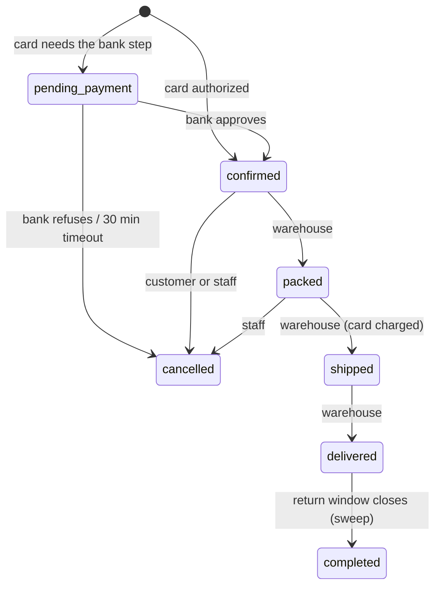
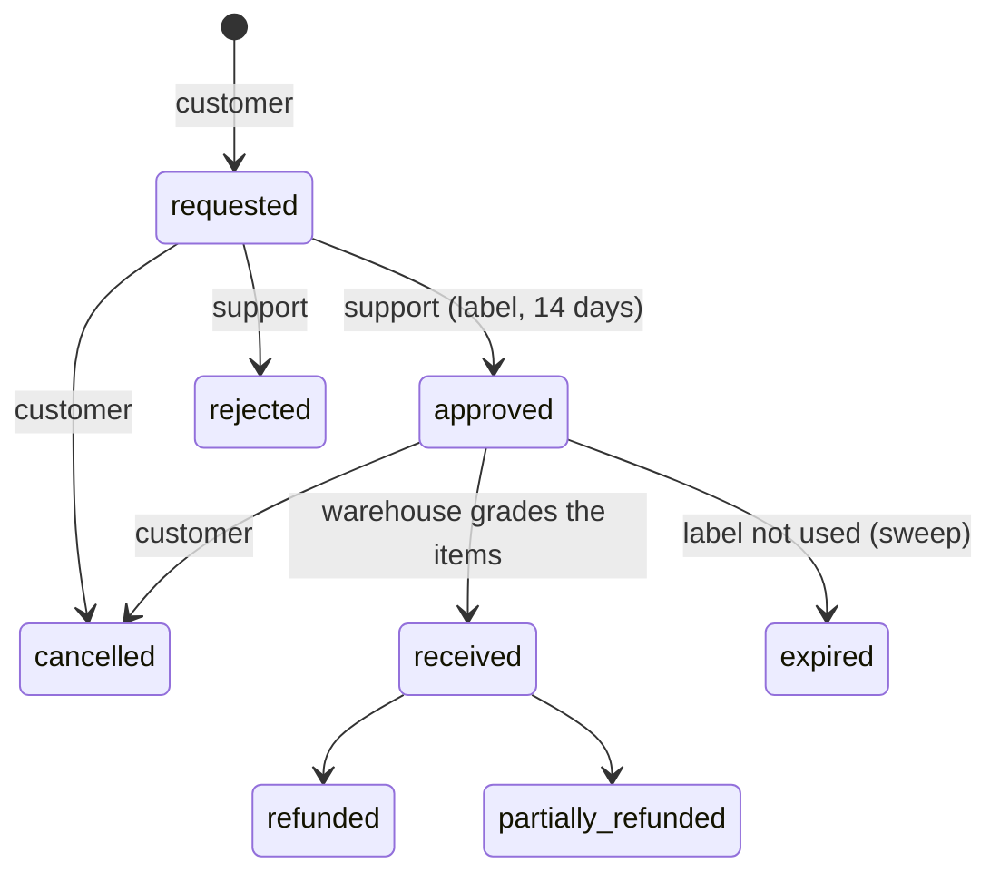

# Testing the Halden API

A practice guide for API automation. Halden is a working shop with real rules (stock, coupons, payments, returns,
refunds, points, roles), so it has the same things you test in a real job, plus a QA lab that lets a test move time,
read emails and switch on planted bugs.

This guide is tool-neutral: the scenarios work the same in Postman, Playwright, REST Assured, pytest or k6. The
[developer guide](API.md) explains how the pieces fit; this one is about testing them.

| | |
|---|---|
| Base URL | `https://halden-api.vercel.app/api/v1` (live) or `http://127.0.0.1:4000/api/v1` (local) |
| Interactive reference | [/api/v1/docs](https://halden-api.vercel.app/api/v1/docs/): every route, field and error, and you can send requests from it |
| OpenAPI 3.1 spec | [/api/v1/docs/openapi.json](https://halden-api.vercel.app/api/v1/docs/openapi.json): for contract tests and code generation |
| Postman | [postman/halden.postman_collection.json](postman/halden.postman_collection.json) (57 requests with tests) and [postman/halden-live.postman_environment.json](postman/halden-live.postman_environment.json). Import both, put the admin password in `adminPassword` as a *current* value (it then stays on your machine), and run the collection in order |

<details>
<summary><b>Contents</b></summary>

1. [The rules every request follows](#1-the-rules-every-request-follows)
2. [Signing in](#2-signing-in)
3. [Test data](#3-test-data)
4. [Your first tests](#4-your-first-tests)
5. [Scenario catalogue](#5-scenario-catalogue): beginner, intermediate, advanced
6. [Catching the planted bugs](#6-catching-the-planted-bugs)
7. [Keeping a suite reliable](#7-keeping-a-suite-reliable)
8. [Quick reference](#8-quick-reference)

</details>

## 1. The rules every request follows

- **JSON in, JSON out.** Writes send `Content-Type: application/json`; anything else is `415`. Field names are
  camelCase.
- **Money is a string** with two decimals: `"84.50"`. Compare it as a string or convert to cents. Never use floats.
- **Ids are numeric strings:** `"42"`, not `42`.
- **Errors** all look the same (RFC 9457, `application/problem+json`). Assert on `status` and `code`. Never assert on
  `detail`, which is wording for people and may change.

  ```json
  {
    "type": "https://halden-outfitters.vercel.app/problems/validation_failed",
    "title": "The request has invalid fields",
    "status": 400,
    "detail": "Please check the form.",
    "code": "validation_failed",
    "requestId": "b0e1…",
    "errors": [{ "path": "password", "message": "At least 10 characters." }]
  }
  ```

- **Lists** are cursor-paginated: `?limit=20`, then `?limit=20&cursor=<nextCursor>` until `nextCursor` is `null`.
  Every list also returns `total`, the number of items that match the filters across all pages.
- **Request ids.** Every response has an `X-Request-Id` header. Send your own (8 to 64 letters, digits or `-`) and it
  shows up in the staff audit log, which helps when a test fails.
- **Rate limits** answer `429` with a `Retry-After` header (seconds). The limits that matter to a test suite:

  | Action | Limit |
  |---|---|
  | Sign in (`/auth/login`, `/auth/token`) | 10 per email per IP and 30 per IP, every 10 minutes |
  | Register | 10 per IP per hour |
  | Apply a coupon | 30 per IP every 10 minutes |
  | Check out | 20 per customer per hour |
  | Forgot password | 3 per email and 10 per IP per hour |

  So **sign in once per test run** and reuse the token. Signing in before every test hits the limit fast.
- **Browsers vs. test tools.** A write that carries an `Origin` header must come from the shop itself
  (`403 origin_not_allowed`). Test tools don't send `Origin`, so you don't need to do anything.

## 2. Signing in

There are two ways, and the API treats them the same.

**Bearer token (use this in test suites):**

```http
POST /api/v1/auth/token
Content-Type: application/json

{ "email": "you@example.test", "password": "…" }
```

```json
201
{
  "accessToken": "kM3x…",
  "tokenType": "Bearer",
  "expiresAt": "2026-11-01T10:00:00.000Z",
  "customer": { "id": "12", "name": "…", "email": "…", "role": "customer", "emailVerified": true, "createdAt": "…" }
}
```

Then send `Authorization: Bearer <accessToken>` on every request. A token lasts 14 days from its last use (at most 90
days), and `POST /auth/logout` with it ends it.

**Cookie (what the website uses):** `POST /auth/login` with the same body sets an HttpOnly `halden_session` cookie.
Postman and most HTTP clients keep cookies for you.

Worth knowing:

- No sign-in, an unknown token, or a token that ended: `401 unauthenticated` with `WWW-Authenticate: Bearer`.
- Signed in but not allowed (a shopper on a staff route): `403 forbidden`.
- If a request has an `Authorization` header, only that header counts. A bad token is `401` even if a valid cookie is
  also sent, and even on routes guests can use (cart, catalogue): an expired token never quietly turns you into a
  guest. Only the `/auth/*` routes ignore a bad token, so you can always get a new one.
- Postman and similar tools keep cookies between requests. To test "no sign-in", turn cookies off for that request
  (in Postman: the request's Settings tab, "Disable cookie jar").

**Roles:**

| Role | Can do |
|---|---|
| `customer` | shop, check out, cancel, return, review |
| `support` | everything in `/staff` that reads; approve or reject returns; goodwill refunds up to 50.00 per order; moderate reviews |
| `warehouse` | pack, ship and deliver orders; receive returns; stock changes |
| `admin` | everything, including products, coupons, rates, tax, the audit log and the QA lab |

## 3. Test data

### Accounts

- **Your own shopper:** `POST /auth/register` with an address at a test domain (`@example.test`, `@example.com`, or
  anything ending in `.test`), then confirm it through the fake inbox (below).
- **A fixture shopper (fastest):** with an admin token, one call makes a confirmed, signed-in account:

  ```http
  POST /api/v1/qa/fixtures/shopper
  Authorization: Bearer <admin token>

  {
    "cart": [{ "slug": "ridgeline-2p-tent", "qty": 1 }],
    "storeCredit": "25.00",
    "points": 300
  }
  ```

  The answer holds the new `customer`, its generated `password`, an `accessToken`, its default `address`, the `cart`,
  and the `storeCredit` and `points` balances. Every field is optional; send `{}` for a confirmed shopper with a US
  address and an empty cart. Other options: `name`, `emailVerified: false`, `address: false`, and
  `role: "support" | "warehouse"` for role tests.

  If a cart line names a product that doesn't exist (`409 product_unavailable`) or asks for more than is in stock
  (`409 not_enough_stock`), nothing is created.

### The fake inbox

The shop never sends real email. Everything it "sends" goes to `GET /qa/inbox?email=<address>`, newest first, and
each email lists its `links`, so a test can follow a confirmation or reset link:

```text
GET /qa/inbox?email=lena@example.test
-> items[0].links[0] = "https://halden-outfitters.vercel.app/verify-email?token=AbC…"
POST /auth/verify-email   { "token": "AbC…" }
```

Anyone can read the inbox of a test-domain address. Staff accounts and the seeded demo accounts are readable by an
admin only.

### The QA lab (admin)

| Endpoint | Use it to |
|---|---|
| `PUT /qa/clock { "offsetSeconds": 2678400 }` | move the shop's time forward (31 days here). Coupons, return windows, label expiry, review edits and payment timeouts all follow this clock. `0` puts it back. It only moves forward |
| `POST /qa/sweeps` | run the time-based jobs now: cancel unpaid orders, expire return labels, complete orders, expire points, deliver webhooks |
| `GET /qa/bugs`, `PUT /qa/bugs/:key { "enabled": true }` | switch a planted bug on or off (section 6) |
| `GET /qa/webhooks?orderId=`, `POST /qa/webhooks/:id/redeliver` | look at payment events, and send one again |

> The clock and the bugs are shared by the whole shop. Put them back (`offsetSeconds: 0`, bugs off) in your
> teardown, even when the test fails.

> **Sessions follow the shop clock too.** A token ends 14 days after its last use in shop time, so moving the clock
> 14 days or more signs everyone out, the admin who moved it included. After a big jump, get a new admin token
> (`POST /auth/token`) before you reset the clock or call other admin routes. Shopper tokens need renewing the same
> way. That is also how you test session expiry (scenario 66).

### Useful seeded data

| What | Value |
|---|---|
| Coupons | `WELCOME10` 10% once per customer · `TRAILHEAD15` 15% on 100.00+, use limit already reached · `SAVE20` 20.00 off 150.00+ · `FREESHIP` free shipping on 40.00+ · `CAMP20` 20% except shelter · `ALLIN25` 25% incl. sale items, twice per customer · `SPRING5` expired · `STAFF50` switched off |
| Shipping | United States 7.95 standard, free from 75.00 · Europe 14.95 · Rest of the world · `express` costs more everywhere |
| Tax | a flat 8% |
| Points | 100 points = 5.00 off, at most half of the subtotal after the coupon |

**Test cards** (any future expiry, any CVC, any name):

| Card | Result |
|---|---|
| `4242 4242 4242 4242` | authorized: `201`, order `confirmed` |
| `4000 0000 0000 0002` | declined: `402 payment_declined` |
| `4000 0000 0000 9995` | insufficient funds: `402` |
| `4000 0000 0000 3220` | needs the bank step: `202`, order `pending_payment`, then `POST /payments/authenticate` |
| `4000 0000 0000 0259` | authorized; a dispute webhook arrives after the card is charged |

## 4. Your first tests

Three tests that show the basic shape: arrange, act, assert.

**1. A public read with a schema check**

```text
GET /products?category=shelter&limit=5
assert  status 200
assert  every items[].price matches /^\d+\.\d{2}$/
assert  items.length <= 5 and total >= items.length
```

**2. A negative test**

```text
POST /auth/token  { "email": "nobody@example.test", "password": "wrong password" }
assert  status 401
assert  body.code == "invalid_credentials"
assert  header content-type starts with "application/problem+json"
```

**3. A chained flow**

```text
POST /qa/fixtures/shopper        (admin)  { "cart": [{ "slug": "ridgeline-2p-tent", "qty": 1 }] }
     -> token, address.id
POST /checkout                   (token, Idempotency-Key: <new uuid>)
     { "shipTo": { "addressId": "<address.id>" }, "shippingMethod": "standard",
       "card": { "number": "4242424242424242", "expMonth": 12, "expYear": 2030, "cvc": "123", "name": "Test" } }
     -> 201, orderId, status "confirmed"
GET  /orders/<orderId>           (token)
assert  status "confirmed", allowedActions contains "cancel"
GET  /cart                       (token)
assert  itemCount == 0
```

The same third test in Playwright (TypeScript):

```ts
import { expect, test } from '@playwright/test';
import { randomUUID } from 'node:crypto';

const API = 'https://halden-api.vercel.app/api/v1';

test('a fixture shopper can buy a tent', async ({ request }) => {
  const admin = await request.post(`${API}/auth/token`, {
    data: { email: process.env.HALDEN_ADMIN_EMAIL, password: process.env.HALDEN_ADMIN_PASSWORD },
  });
  const adminToken = (await admin.json()).accessToken;

  const fixture = await request.post(`${API}/qa/fixtures/shopper`, {
    headers: { authorization: `Bearer ${adminToken}` },
    data: { cart: [{ slug: 'ridgeline-2p-tent', qty: 1 }] },
  });
  expect(fixture.status()).toBe(201);
  const shopper = await fixture.json();
  const auth = { authorization: `Bearer ${shopper.accessToken}` };

  const checkout = await request.post(`${API}/checkout`, {
    headers: { ...auth, 'idempotency-key': randomUUID() },
    data: {
      shipTo: { addressId: shopper.address.id },
      shippingMethod: 'standard',
      card: { number: '4242424242424242', expMonth: 12, expYear: 2030, cvc: '123', name: 'Test' },
    },
  });
  expect(checkout.status()).toBe(201);
  const { orderId } = await checkout.json();

  const order = await (await request.get(`${API}/orders/${orderId}`, { headers: auth })).json();
  expect(order.status).toBe('confirmed');
  expect(order.allowedActions).toContain('cancel');
});
```

Keep the admin password in environment variables or CI secrets, never in the test code.

## 5. Scenario catalogue

Each row is a test worth writing. **Endpoints** shows the calls, **Check** shows what to assert. Work down the levels:
each one builds on the skills of the one before.

<details open>
<summary><b>Level 1: beginner</b> (one request, status codes, body and schema checks)</summary>

| # | Scenario | Endpoints | Check |
|---|---|---|---|
| 1 | Health check | `GET /health` | 200 `{ "status": "ok", "database": "ok" }` |
| 2 | List categories | `GET /categories` | 200, non-empty, each has `slug` and `name` |
| 3 | Product list matches the OpenAPI schema | `GET /products` | every field and type matches `ProductPage` in the spec |
| 4 | Filter by category | `GET /products?category=shelter` | every item's category is shelter; `total` matches when you page through |
| 5 | Price range filter | `GET /products?minPrice=50&maxPrice=100` | every price is between 50.00 and 100.00 |
| 6 | Search | `GET /products?q=tent` | every name or summary contains "tent" |
| 7 | Sort by price | `GET /products?sort=price-asc` (also `price-desc`, `newest`, `rating`) | prices never go down |
| 8 | Product by slug | `GET /products/ridgeline-2p-tent` | 200, gallery and related products |
| 9 | Unknown product | `GET /products/no-such-thing` | 404 `not_found` |
| 10 | Unknown route | `GET /nothing-here` | 404 `route_not_found`, problem+json |
| 11 | Register | `POST /auth/register` | 201, `emailVerified: false`, a verification email in the inbox |
| 12 | Register validation | `POST /auth/register` with a bad email, a short or common password, a missing name | 400 `validation_failed`, one `errors[]` entry per field |
| 13 | Email already taken | register the same email twice, in a different case | 409 `email_taken` |
| 14 | Get a token | `POST /auth/token` | 201, `tokenType: "Bearer"`, no `Set-Cookie` |
| 15 | Wrong password | `POST /auth/token` | 401 `invalid_credentials` |
| 16 | No token | `GET /orders` without auth | 401 `unauthenticated`, `WWW-Authenticate` header |
| 17 | Wrong role | `GET /staff/orders` as a shopper | 403 `forbidden` |
| 18 | Not JSON | `POST /cart/items` with `Content-Type: text/plain` | 415 |
| 19 | Broken JSON | `POST /cart/items` with `{"qty":` | 400 `invalid_json` |
| 20 | Countries | `GET /countries` | US, SE and JP are there, each with a `code` and `name` |

</details>

<details>
<summary><b>Level 2: intermediate</b> (CRUD, chained requests, state, pagination, auth flows)</summary>

| # | Scenario | Endpoints | Check |
|---|---|---|---|
| 21 | Address CRUD | `POST`, `GET`, `PUT`, `DELETE /account/addresses` | each change shows in the next GET; deleting the default moves the default to another address |
| 22 | Address book limit | add a 6th address | 409 `address_limit_reached` |
| 23 | Cart: add, change, remove | `POST /cart/items`, `PATCH /cart/items/:productId`, `DELETE …` | `itemCount` and `subtotal` follow each step |
| 24 | Over the stock | add more than `available` | 409 `not_enough_stock` |
| 25 | Over the line limit | `qty: 21` | 400, `errors[0].path == "qty"` |
| 26 | Apply a coupon | `POST /cart/coupon { "code": "WELCOME10" }` | `discount` is 10% of the subtotal |
| 27 | Coupons that must fail | `SPRING5`, `STAFF50`, `TRAILHEAD15`, `SAVE20` under 150.00 | 409 `coupon_invalid` each time |
| 28 | Quote | `POST /checkout/quote` | `total = subtotal − discount + shipping + tax`; tax is 8% |
| 29 | Free shipping | quote a US order over 75.00 | shipping `"0.00"`; `toFreeShipping` is null |
| 30 | Shipping by zone | quote the same cart to US, SE, JP | three different shipping prices |
| 31 | Place an order | `POST /checkout` with card 4242 | 201 `confirmed`; the cart is empty |
| 32 | Declined card | card …0002 | 402 `payment_declined`; the order is `cancelled` (reason `payment_failed`), stock is released and the cart is kept |
| 33 | Bank step approved | card …3220, then `POST /payments/authenticate { token, approve: true }` | 202 `pending_payment`, then `confirmed` |
| 34 | Bank step refused | the same with `approve: false` | the order ends `cancelled`, reason `payment_failed` |
| 35 | My orders, paged | `GET /orders?limit=1` and follow `nextCursor` | newest first, no repeats, `total` equals the count |
| 36 | Someone else's order | `GET /orders/:id` with another shopper's token | 404, not 403, so it gives nothing away |
| 37 | Customer cancels | `POST /orders/:id/cancel { "reason": "changed_mind" }` | `cancelled`; stock goes back; `allowedActions` is empty |
| 38 | Order lifecycle | warehouse: `pack`, `ship { trackingNumber }`, `deliver` | each step changes `status`; skipping a step is 409 `invalid_transition` |
| 39 | Cancel too late | cancel a shipped order as the customer | 409 |
| 40 | Email confirmation | register, read the inbox, `POST /auth/verify-email` | `emailVerified` becomes true; using the link again is 410 `token_invalid` |
| 41 | Password reset | `POST /auth/forgot-password`, read the inbox, `POST /auth/reset-password` | the old password stops working, the new one works, other sessions end |
| 42 | Unknown email on reset | `POST /auth/forgot-password` with an unknown address | still 202: it must not reveal which emails have accounts |
| 43 | Sessions | sign in twice, `GET /account/sessions`, `DELETE /account/sessions/:id` | the removed token gets 401 |
| 44 | Logout | `POST /auth/logout` | the same token gets 401 afterwards |
| 45 | Staff lists and filters | `GET /staff/orders?status=delivered`, `GET /staff/customers?q=maya` | every item matches the filter; `total` matches |

</details>

<details>
<summary><b>Level 3: advanced</b> (idempotency, concurrency, time, money maths, webhooks, contracts)</summary>

| # | Scenario | Endpoints | Check |
|---|---|---|---|
| 46 | Idempotent checkout | send `POST /checkout` twice with the same `Idempotency-Key` and body | one order; the second answer is the same, with `Idempotent-Replayed: true` |
| 47 | Key reused with another body | same key, different body | 422 `idempotency_key_reused` |
| 48 | Missing key | `POST /checkout` without the header | 400 `idempotency_key_missing` |
| 49 | Race for the last item | two shoppers check out the last unit at the same time | exactly one 201, the other 409 (`out_of_stock`, `not_enough_stock` or `cart_has_problems`); `available` ends at 0, never below |
| 50 | Optimistic locking | admin: `GET /staff/products/:id` (ETag), `PATCH` with `If-Match` twice | first 200 with a new ETag; the stale one 412; no `If-Match` is 428 |
| 51 | Lockout | 5 wrong passwords for a non-demo account | 423 `account_locked` with `Retry-After`; an email in the inbox |
| 52 | Rate limit | 11 correct sign-ins in a row for one email | the 11th is 429 `rate_limited` with `Retry-After` |
| 53 | Unpaid order times out | card …3220, don't answer; clock +31 min; `POST /qa/sweeps` | the order is `cancelled` with reason `payment_timeout`; stock is back |
| 54 | Return window | deliver an order; clock +31 days; new tokens (see the clock note in section 3); `POST /orders/:id/returns` | 409 `return_not_allowed` |
| 55 | Full return flow | return → support approves → warehouse receives `as_new` | `refunded`; the refund equals what was paid for the line, coupon share included |
| 56 | Restocking fee | receive as `opened` | 15% fee taken off the refund |
| 57 | Store-credit refund | `refundMethod: "store_credit"` | `GET /account/store-credit` goes up; the card is not refunded |
| 58 | Paying with credit and points | fixture with credit and points; quote with `useStoreCredit` and `pointsToRedeem: 200` | 10.00 off; credit used first; `amountDue` is what's left |
| 59 | Points earned | deliver an order; then complete it (clock + sweep) | points `pending`, then `available`; tax and shipping earn nothing |
| 60 | Goodwill limit | support: `POST /staff/orders/:id/goodwill { amount: "60.00", reason }` with an `Idempotency-Key` | 409 `refund_limit_exceeded`; the same as admin is 200 |
| 61 | Webhook replay | `GET /qa/webhooks?orderId=`, then `redeliver` | 200, nothing changes the second time |
| 62 | Contract test | load the OpenAPI spec and check every response you get against it | no field missing or of the wrong type |
| 63 | Audit trail | do a staff write with your own `X-Request-Id` | `GET /staff/audit` has the entry, with before, after and your request id |
| 64 | Expired coupon by clock | create a coupon that ends tomorrow; clock +2 days | 409 `coupon_invalid` |
| 65 | Reviews | buy and deliver, `POST /products/:slug/reviews`; support hides it | the product rating and count go back to what they were |
| 66 | Session expiry | get a token; clock +15 days | the token gets 401 everywhere, even on `GET /cart`; a new `POST /auth/token` works |

</details>

## 6. Catching the planted bugs

The shop has 18 deliberate bugs, all off by default. A good suite stays green while they are off and goes red when one
is switched on. Use `GET /qa/bugs` for the current list with the steps to see each one; `PUT /qa/bugs/:key` switches
one on or off.

The pattern:

```text
setup:     PUT /qa/bugs/<key> { "enabled": true }
test:      the scenario from the table
expect:    your normal assertion FAILS (that is the point: you've caught it)
teardown:  PUT /qa/bugs/<key> { "enabled": false }
```

| Bug key | What goes wrong | Scenario that catches it |
|---|---|---|
| `coupon_twice` | The coupon is applied twice | 26, 28 |
| `coupon_limit_ignored` | A used-up coupon still works | 27 (`TRAILHEAD15`) |
| `coupon_customer_limit_ignored` | `WELCOME10` works twice for one account | buy twice with `WELCOME10` |
| `cancel_keeps_coupon_use` | Cancelling doesn't give the coupon use back | 37 with a limited coupon |
| `cancel_keeps_reservation` | Cancelling keeps the stock held | 37: check `available` after |
| `cancel_leaves_authorization` | The card stays authorized after a cancel | 37: check the order's payment |
| `payment_misses_shipping` | The card is charged less than the total | 31 under 75.00: payment == total |
| `eu_domestic_rate` | Europe pays the US shipping rate | 30 |
| `refund_ignores_discount` | A refund ignores the coupon share | 55 with `CAMP20` |
| `refund_over_captured` | Refunds can be more than was paid | 55, then a goodwill refund on top |
| `store_credit_double` | A store-credit refund also refunds the card | 57 |
| `restock_damaged` | Faulty returns go back into stock | 55 graded `faulty`: stock must not go up |
| `return_window_restarts` | A cancelled return resets the window | return, cancel, clock forward, return again |
| `support_goodwill_unlimited` | Support can refund any amount | 60 |
| `points_on_tax_shipping` | Points are earned on tax and shipping | 59 |
| `returned_keeps_points` | Returned lines keep their pending points | 59 + a return |
| `hidden_reviews_counted` | Hidden reviews still count in the rating | 65 |
| `price_edit_rewrites_orders` | A price edit changes past orders | 50: old orders must keep their price |

Each bug also breaks one SQL rule in [`qa/rules.sql`](../qa/rules.sql), so you can check the database side with
[Propmaster](https://github.com/rameshlakmal/propmaster).

## 7. Keeping a suite reliable

- **One token per role per run.** Get the admin, support and warehouse tokens once in global setup, and make each test
  its own shopper with the fixture endpoint. That avoids rate limits, and tests can't step on each other.
- **Unique data.** Use the fixture's generated email, or add a random suffix to anything you create (coupon codes,
  product SKUs).
- **Don't depend on order.** Every test should pass when run alone, in any order.
- **Reset shared state in teardown:** the clock (`offsetSeconds: 0`) and any bug you switched on. Run the teardown even
  when the test fails.
- **Don't run clock tests in parallel.** The clock is shop-wide, so run those tests one at a time. Remember that a jump
  of 14 days or more ends every token.
- **Stock is shared.** Prefer products with plenty of stock, and read `available` before you assert on it rather than
  hard-coding a number.
- **Log the request id** of a failing call. It ties the failure to the audit log entry.
- **Live vs. local.** The live API is shared and rate-limited; for heavy runs, run Halden locally
  ([DEVELOPING.md](DEVELOPING.md)) and use `RATE_LIMITS=false`.

## 8. Quick reference

<details>
<summary><b>Status codes and error codes</b></summary>

| Status | Codes |
|---|---|
| 400 | `validation_failed`, `invalid_json`, `idempotency_key_missing` |
| 401 | `unauthenticated`, `invalid_credentials`, `webhook_signature_invalid` |
| 402 | `payment_declined`, `payment_failed` |
| 403 | `forbidden`, `origin_not_allowed`, `email_not_verified`, `review_not_allowed` |
| 404 | `not_found`, `route_not_found`, `qa_lab_disabled` |
| 409 | `conflict`, `invalid_transition`, `out_of_stock`, `not_enough_stock`, `coupon_invalid`, `cart_has_problems`, `cart_empty`, `shipping_unavailable`, `return_not_allowed`, `refund_limit_exceeded`, `already_reviewed`, `idempotency_in_progress`, `email_taken`, `address_limit_reached`, `product_unavailable` |
| 410 | `token_invalid` |
| 412 / 428 | `precondition_failed` / `precondition_required` |
| 413 | `payload_too_large` (bodies over 64 KB) |
| 415 | `unsupported_media_type` |
| 422 | `idempotency_key_reused` |
| 423 | `account_locked` |
| 429 | `rate_limited` |
| 503 | `service_unavailable` (the database is down; `GET /health` says so too) |

The full list, with each code's status, is in [`packages/contracts/src/errors.ts`](../packages/contracts/src/errors.ts).

</details>

<details>
<summary><b>States</b></summary>





Enums you'll send:

- Cancel reasons: `changed_mind`, `ordered_by_mistake`, `found_cheaper`, `delivery_too_slow`, `other`
- Return reasons: `damaged`, `wrong_item`, `not_as_described`, `changed_mind`, `too_small`, `too_large`, `not_needed`, `other`
- Item conditions: `as_new` (full refund), `opened` (15% fee unless shop fault), `damaged_by_customer` (no refund), `faulty` (full refund, written off)
- Refund methods: `card`, `store_credit`
- Shipping methods: `standard`, `express`

</details>
